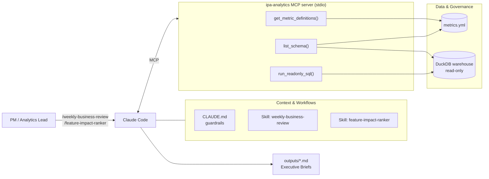

# IPA AI Co-Pilot — Governed Product Analytics with MCP & Claude Skills

An AI-first product analytics prototype. It shows how **Model Context Protocol (MCP)**, **version-controlled semantic definitions** and **modular Agent Skills (`SKILL.md`)** can automate recurring Product Management workflows without losing metric accuracy.

The data mirrors a multi-product B2B SaaS observability business: 500 SMB, Mid-Market and Enterprise accounts, 4 product lines, 12 weeks of usage telemetry, and 100 unstructured support tickets.

**Read the results first, no setup needed:**
- 📈 [`outputs/sample_wbr_brief.md`](outputs/sample_wbr_brief.md): VP-ready Weekly Business Review
- 🧭 [`outputs/sample_feature_ranking.md`](outputs/sample_feature_ranking.md): revenue-weighted feature prioritization

---

## Why This Architecture Matters
Ad-hoc LLM SQL generation fails in production product analytics for two reasons:
- **Metric drift:** different prompts compute NRR or adoption in different ways.
- **Unstructured blind spots:** usage drops get reported without any qualitative context.

This repository addresses both by splitting the work into three layers:
1. **Semantic governance (`data/metrics.yml`):** the single source of truth for KPI formulas, grains, filters, cohort exclusions and the reporting calendar. Agents read it through a read-only MCP tool. It is never pasted into prompts.
2. **Deterministic execution (`mcp_server/server.py`):** an MCP server in front of a DuckDB warehouse that accepts one `SELECT`/`WITH` statement per call. The connection is read-only, external file and network access is off, and write, DDL and extension keywords are rejected. Each result returns its SQL and `row_count` so it can be cited.
3. **Standardized analytical SOPs (`.claude/skills/`):** reusable `SKILL.md` workflows, together with the guardrails in `CLAUDE.md`, enforce segmentation, root-cause triangulation and citations on every run.

### Why keep `metrics.yml` separate from `SKILL.md`?
A skill describes **how to run an analysis**. The semantic layer describes **what a number means**. If a WBR skill, a QBR skill and a churn skill each carried its own NRR formula, a 30+ product org would end up with three NRRs within a quarter. With the split:
- each KPI is defined once, and every skill, agent and human analyst resolves it through `get_metric_definitions()`;
- changing a definition (for example, excluding net-new logos from NRR) is one reviewed PR to one file, and the change reaches every workflow at once;
- skills stay short and readable for PMs, because they reference metric *names*, not SQL.

`CLAUDE.md` connects the two layers. Rule 1 is *"call `get_metric_definitions()` before writing KPI SQL"*.

---

## System Architecture



---

## Automated Workflows

### 1. Weekly Business Review (`/weekly-business-review`)
- Compares week-over-week Product Adoption Rate (bps), Ingestion (GB, %), and ARR, NDR and Expansion ARR across every `product_name × arr_tier` cell.
- Flags cells that move more than ±5% in ingestion or ±300 bps in adoption, sizes the affected accounts and their ARR and 90-day renewals, then checks recent support tickets for a root cause.
- **What it found in the sample run:** Log Management looks only mildly soft at the platform level (−3.9% WoW). Segmented, it is a **−18.0% drop in Mid-Market**. 34 accounts ($7.57M ARR, $4.81M renewing within 90 days) paused or throttled log shipping, and 22 of them had filed overage-pricing tickets in the previous 14 days. → [`outputs/sample_wbr_brief.md`](outputs/sample_wbr_brief.md)

### 2. Revenue-Weighted Feature Prioritizer (`/feature-impact-ranker`)
- Classifies unstructured tickets with an ordered, auditable taxonomy in SQL. Tickets that fall through are reviewed by judgment and counted separately.
- Joins themes to deduplicated account ARR, 90-day renewals and CSM health, and ranks the backlog by revenue impact.
- Reports how sensitive the ranking is to the weighting. For example, RBAC/SSO leads on total ARR ($12.4M), but Log Overage leads on at-risk accounts (16 of 22). → [`outputs/sample_feature_ranking.md`](outputs/sample_feature_ranking.md)

---

## Quickstart

```bash
uv sync                                  # duckdb, mcp, pyyaml (+ pytest)
uv run python data/seed_data.py          # build data/saas_analytics.duckdb (deterministic, seed=42)
uv run pytest -q                         # validator tests + MCP stdio round trip
claude                                   # Claude Code picks up .mcp.json, CLAUDE.md and .claude/skills
```

When Claude Code prompts you, approve the project MCP server `ipa-analytics`. Then run either workflow:
- `/weekly-business-review`
- `/feature-impact-ranker`

Or ask in plain language, for example *"Why did Log Management usage dip last week?"* Skills load automatically from their `description`.

---

## Repository Layout

```text
prodanalytics-ai-copilot/
├── CLAUDE.md                        # Persistent analytical guardrails & segmentation rules
├── .mcp.json                        # Registers the ipa-analytics MCP server for Claude Code
├── .claude/skills/
│   ├── weekly-business-review/      # WoW KPI scorecard & anomaly root-cause SOP
│   └── feature-impact-ranker/       # Ticket classification & ARR-weighting SOP
├── data/
│   ├── metrics.yml                  # Governed semantic KPI definitions + reporting calendar
│   └── seed_data.py                 # Synthetic DuckDB generator (planted Mid-Market anomaly)
├── mcp_server/
│   └── server.py                    # Read-only SQL & semantic-layer MCP server
├── tests/
│   └── test_mcp_server.py           # SQL guard tests + end-to-end MCP stdio test
└── outputs/
    ├── sample_wbr_brief.md          # Generated VP-ready WBR (with query appendix)
    └── sample_feature_ranking.md    # Generated PM prioritization matrix (with query appendix)
```

## Implementation Notes
- Built on the official Python MCP SDK v2. `MCPServer` replaces v1's `FastMCP` and uses the same decorator-based tool API. All three tools carry `readOnlyHint` annotations.
- The dataset is a fixed snapshot: the latest complete week is 2026-11-02 and the as-of date is 2026-11-09. Renewal windows are computed from `reporting_calendar` and never from `CURRENT_DATE`, so reruns give the same results.
- The keyword guard on SQL is defense in depth. The actual boundary is the DuckDB `read_only` connection with `enable_external_access = false`.
- All data is synthetic. Company names are randomly generated.
